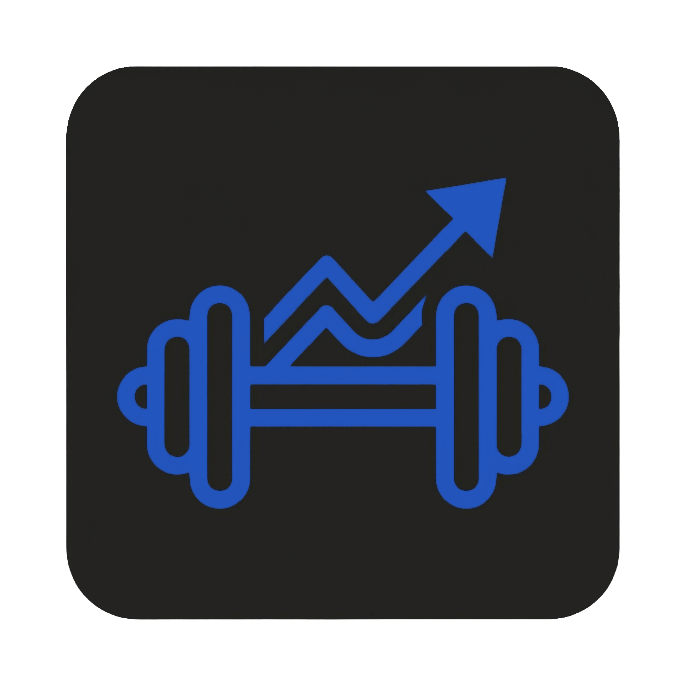
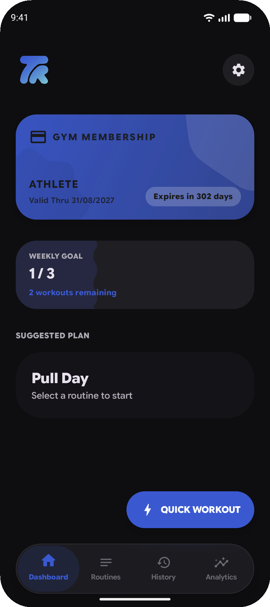
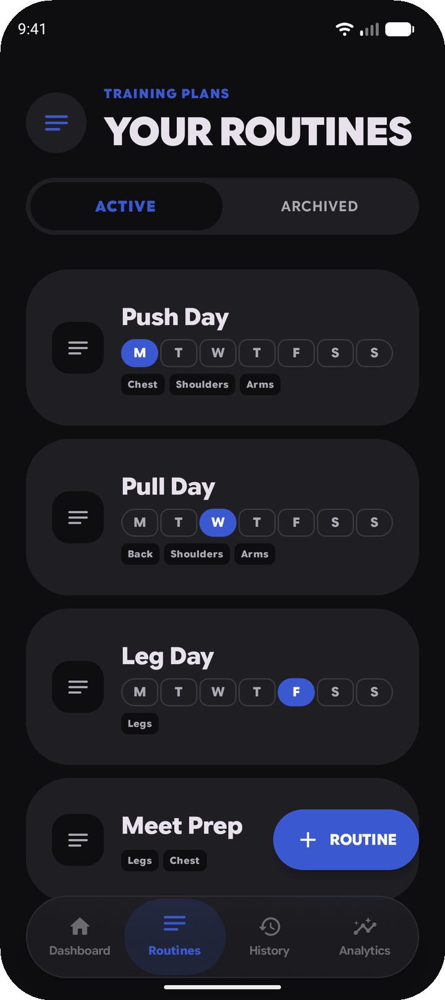
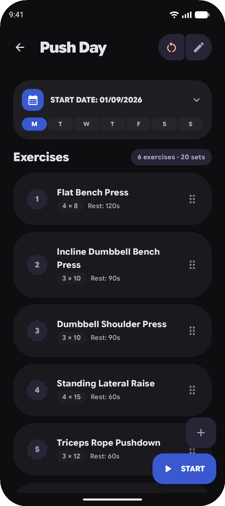
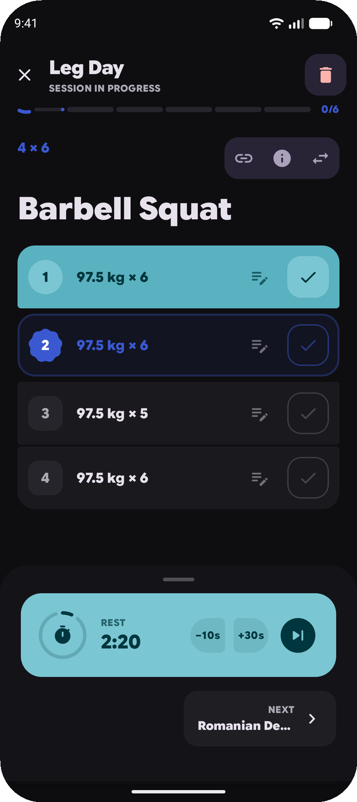
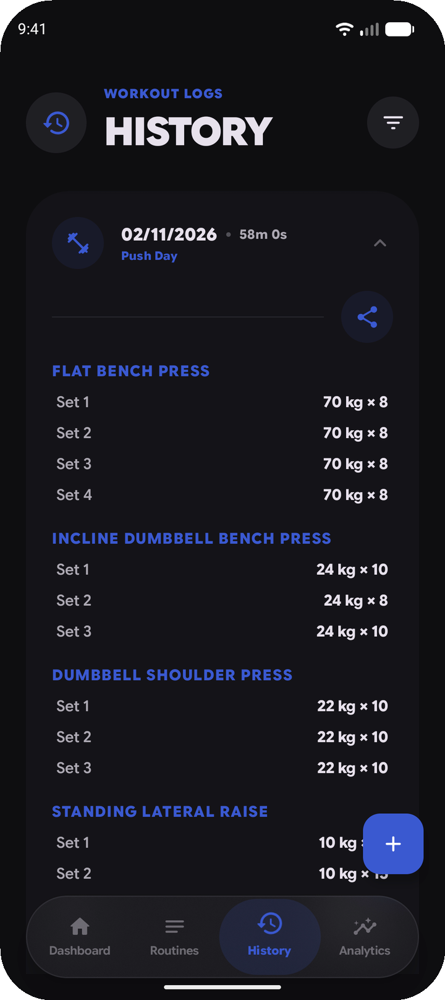
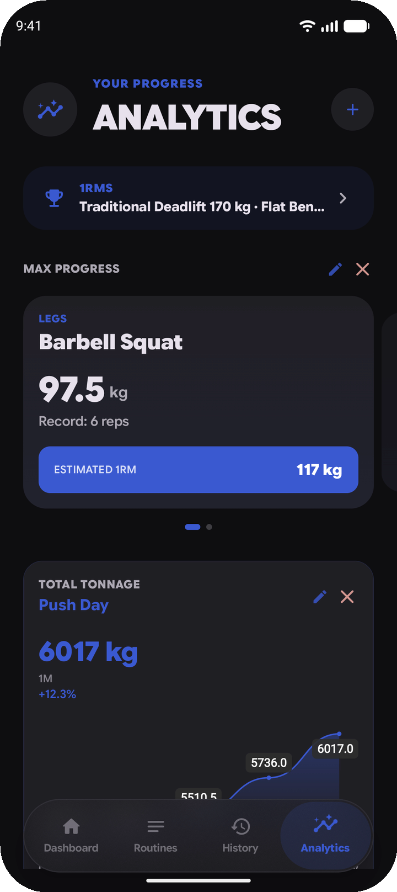
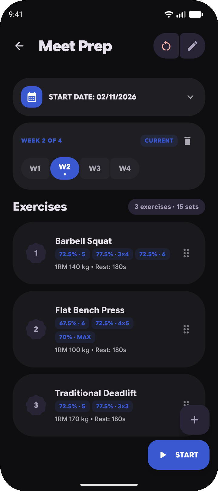
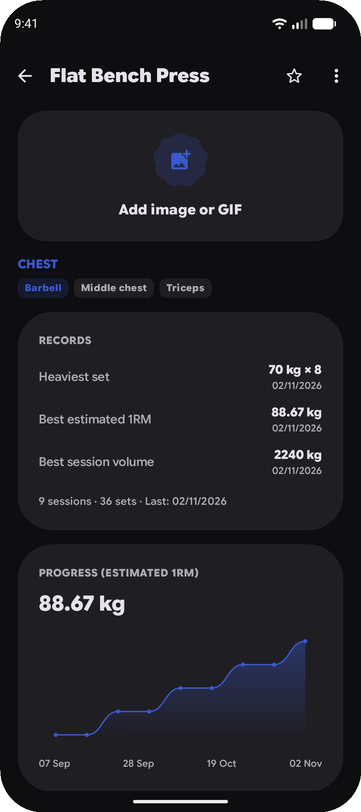

<div align="center">



# Trainable

**A native Android workout tracker for lifters.**
Plan your routines, log every set and follow your progress. Your data stays on your phone.

[](https://github.com/Emanuel5014/Trainable/releases/latest)
[](#installation)
[](LICENSE)
[](https://trainableapp.vercel.app)

[Download](https://github.com/Emanuel5014/Trainable/releases/latest/download/Trainable.apk) &nbsp;|&nbsp;
[Features](#features) &nbsp;|&nbsp;
[Installation](#installation) &nbsp;|&nbsp;
[Build from source](#build-from-source) &nbsp;|&nbsp;
[Releases](https://github.com/Emanuel5014/Trainable/releases)

</div>

<br>

<p align="center">
  
  
  
  
</p>
<p align="center">
  
  
  
  
</p>
<p align="center">
  <sub>Dashboard, routines, routine detail and a workout in progress. History, analytics, a weekly %1RM program and exercise records.</sub>
</p>

## Overview

Trainable is a workout tracker built with Jetpack Compose and Material 3 Expressive. It handles a plain push, pull and legs split as well as week-by-week %1RM programs, and it works without an account or an internet connection.

- **Local first.** Everything lives in a Room database on the device. Backups go to a file or to your own Nextcloud.
- **Simple by default.** Percentage-based programming, techniques and RPE targets sit behind one switch (Settings, Workout, Advanced programming) that is off until you need it.
- **Scan a paper plan.** Photograph a gym sheet and let an on-device model, or a provider you choose, turn it into a routine.
- **Your language and units.** English, Italian, Portuguese, German, French and Spanish, in kilograms or pounds.

## Features

### Training

- **Dashboard.** The routine suggested for today, weekly goal progress, one-tap resume of an interrupted workout and a quick start without a plan.
- **Routine builder.** More than 140 preset exercises with filters by category, muscle and equipment, plus your own exercises and categories, favorites, supersets, drag-and-drop ordering and scheduling by weekday with start and expiry dates.
- **Flexible rep schemes.** Fixed sets, per-set lists such as `10-8-6`, rep ranges with double progression, optional starting weights, time-based sets and cardio.
- **Workout screen.** Large touch targets with wheel pickers, a rest timer with notifications, a warm-up timer, per-set notes, swiping between exercises, adding or swapping exercises mid-workout, a plate calculator and optional RPE on three scales.
- **Set detail.** Optional logging of rest-pause parts, assisted and partial reps and the technique actually performed.
- **Own media.** Attach an image or GIF to any exercise and show it during the workout.

### Advanced programming

Opt-in. With the switch off, the app behaves like a plain tracker and your programmed data is kept for when you turn it back on.

- **Prescriptions as blocks**, for example `70% 5 / 75% 3x5 / 70% 6`, with %1RM, RPE, fixed load or bodyweight intensity.
- **Every rep mode.** Sets by reps, per-set lists, AMRAP and total-rep targets that add sets until the goal is reached.
- **Techniques.** Pauses, chains, bands, tempo, deficit, EMOM and custom cues, shown as chips everywhere.
- **Weekly programs.** Any number of weeks with a prescription per week, skipped weeks, copy from the previous week and automatic week advance after each session.
- **1RM manager.** Per-exercise maxes with history and source (tested, manual, estimated), an Epley estimate from your logs and a load table rounded to your plate increment.
- **Edit while training.** Change a prescription in the middle of a workout, for that workout only or for the whole routine.

### History and analytics

- **History.** Edit past workouts, filter, compare two sessions and share a workout as an image card. An optional journal adds a rating, a note and colored tags to each workout.
- **Analytics.** Widgets you arrange yourself: workout calendar, body weight, volume by muscle group, total tonnage, 1RM progress and period comparison.
- **Exercise records.** Per exercise: heaviest set, best estimated 1RM, best session volume and a progress chart.
- **Reports.** Generate an HTML report of one or more routines with per-exercise history, maximums and, for programs, prescribed versus done by week.

### AI sheet scanner

- **On-device by default.** Google LiteRT-LM running Gemma 4 (E2B or E4B). No account, no API key, no data leaves the phone. Needs a device with roughly 6 GB of RAM.
- **Or a provider you choose.** Claude, OpenAI, Gemini or any OpenAI-compatible server, such as Ollama or LM Studio on your own PC. Keys are stored encrypted with the Android Keystore and you confirm before a photo is sent to a public service.
- **Reads real sheets.** Exercise names, sets, reps, rest, cardio, %1RM notation, techniques and multi-week programs, matched against the exercise catalog and shown for review before anything is imported.

### Data and integrations

- **Backup and restore.** Local ZIP backups, scheduled automatic backups with WorkManager and optional Nextcloud sync.
- **CSV.** Export your history, or import one from another app: a full preview, duplicate detection and a one-tap undo.
- **Routine sharing.** Export and import routines as `.trainableplan` files, photos included.
- **Local web dashboard.** Start a small Ktor server from Settings and browse your plans, history and analytics from any browser on the same Wi-Fi network.
- **Widgets.** Quick start or resume, and weekly goal progress, on the home screen.

### Physical checks

A hidden section for body progress, opened by tapping the logo on the dashboard three times: measurements with notes, photos with a fullscreen viewer and a before and after slider, a built-in photo editor, biometric or PIN lock, optional AES-256-GCM encryption of the photos and auto-lock when the app goes to the background.

### Personalization

- Material You dynamic colors, a set of palettes or a custom color, light, dark or system theme.
- Three navigation bar styles: floating, expressive and classic.
- Gym membership card with expiry alerts, haptic feedback and swipe or long-press interaction styles.

## Installation

1. Download [`Trainable.apk`](https://github.com/Emanuel5014/Trainable/releases/latest/download/Trainable.apk) from the latest release.
2. Open it on your phone and allow installs from that source when asked.
3. Later versions are announced inside the app, which can download and install the update.

| Requirement | Detail |
| :--- | :--- |
| Android | 9 (API 28) or newer. Wallpaper-based dynamic color needs Android 12 or newer. |
| On-device AI | About 6 GB of RAM and at least 3 GB of free storage for the model. Remote providers work on any device. |

## Build from source

Requirements: a recent Android Studio, the Android SDK platform 37 and JDK 21 (Gradle finds an installed JDK or downloads one).

```bash
git clone https://github.com/Emanuel5014/Trainable.git
cd Trainable
./gradlew :app:assembleDebug
```

The APK is written to `app/build/outputs/apk/debug/`. The debug build uses the application ID `com.emanuel5014.trainable.debug`, so it installs next to the release version without touching its data.

## Architecture

Clean architecture with MVVM. Dependencies point inwards: the UI knows the view models, the view models know the domain and the repositories, and the domain knows nothing about Android.

| Layer | Contents |
| :--- | :--- |
| UI | Jetpack Compose only, no XML layouts. Type-safe navigation with `@Serializable` routes. |
| Presentation | Hilt-injected view models exposing `StateFlow`. |
| Domain | Plain Kotlin logic: prescriptions, suggestions, RPE, EMOM, CSV import planning. |
| Data | Room (single source of truth), DataStore, WorkManager, the Ktor web server and the on-device AI engine. |

```
com/emanuel5014/trainable/
├── data/        Room database (entities, DAOs), repositories, AI (on-device and remote), HTML reports
├── domain/      Prescriptions, suggestions, RPE, EMOM, CSV import, exercise rules
├── di/          Hilt modules
├── ui/          Screens, components, navigation, theme
├── util/        Backup, notifications, crypto, locale, sharing, updates
├── webserver/   Local Ktor server and its foreground service
└── widget/      Glance widgets
```

## Tech stack

| Area | Library |
| :--- | :--- |
| Language | Kotlin 2.4 |
| UI | Jetpack Compose (BOM 2026.09), Material 3 1.5, Haze |
| Dependency injection | Hilt 2.60 |
| Database | Room 2.8 with KSP |
| Preferences | DataStore 1.2 |
| Background work | WorkManager 2.12 and foreground services |
| Navigation | Navigation Compose 2.9 |
| Networking | OkHttp 5.5 and Ktor server 3.5 |
| Serialization | kotlinx.serialization 1.11 |
| On-device AI | LiteRT-LM 0.16 (Gemma 4) |
| Images | Coil 2.7 |
| Widgets | Glance 1.2 |
| Charts | Custom Compose Canvas drawing |
| Build | Gradle 9.6 and Android Gradle Plugin 9.4 |

## Contributing

Bug reports and feature requests are welcome in the [issue tracker](https://github.com/Emanuel5014/Trainable/issues). For a code change, open an issue first so the approach can be discussed.

## Support

If Trainable is useful to you, a star on GitHub helps other lifters find it. Development can also be supported on [Ko-fi](https://ko-fi.com/emanuel5014).

## License

Released under the [GNU General Public License v3.0](LICENSE).

Logo by br1_production.
