<div align="center">

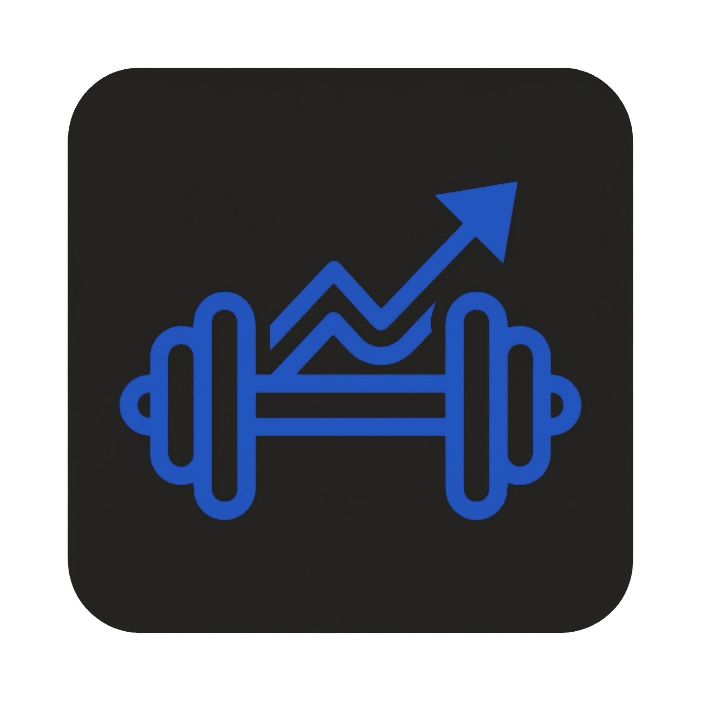

# Trainable

**A workout tracker for lifters, on Android and iPhone.**
Plan your routines, log every set and follow your progress. Your data stays on your phone.

[](https://github.com/Emanuel5014/Trainable/releases/latest)
[](#android)
[](#iphone)
[](LICENSE)
[](https://trainableapp.vercel.app)

<a href="https://github.com/Emanuel5014/Trainable/releases/latest/download/Trainable.apk"></a>
<a href="https://trainableapp.vercel.app/altstore/add/"></a>

[Install on iPhone](#iphone) &nbsp;|&nbsp;
[Features](#features) &nbsp;|&nbsp;
[Build from source](#build-from-source) &nbsp;|&nbsp;
[Releases](https://github.com/Emanuel5014/Trainable/releases)

</div>

<br>

<p align="center">
  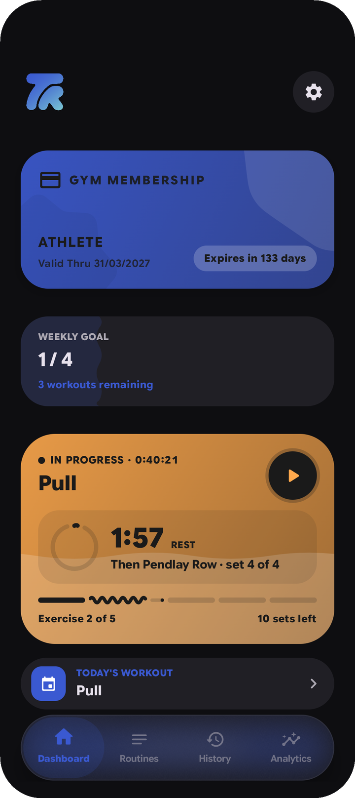
  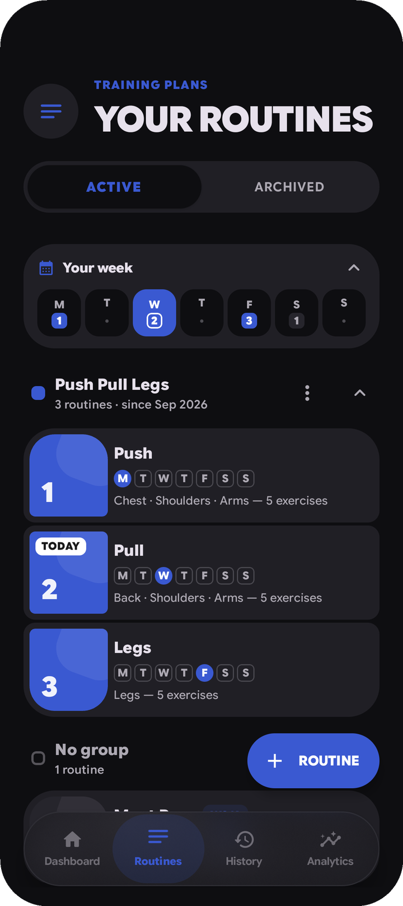
  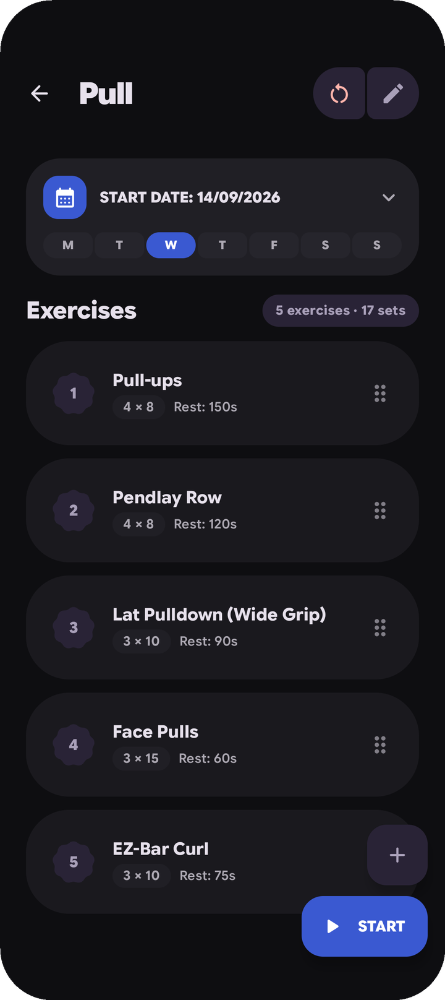
  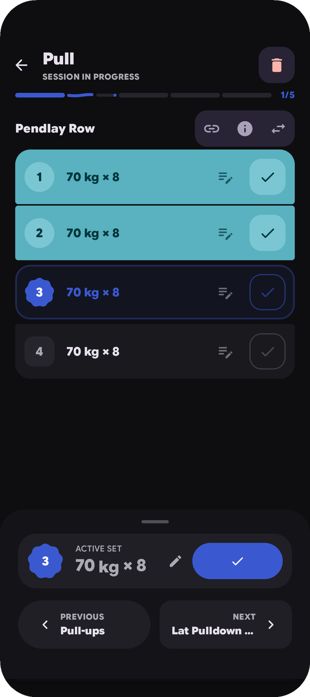
</p>
<p align="center">
  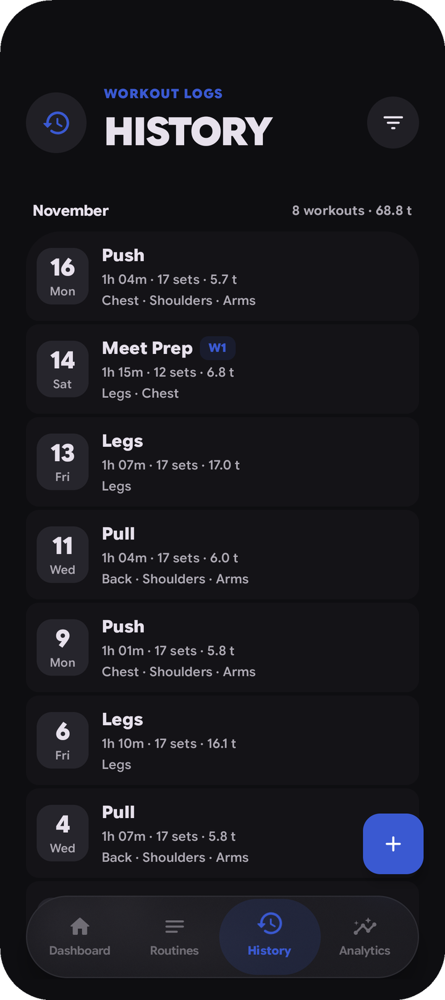
  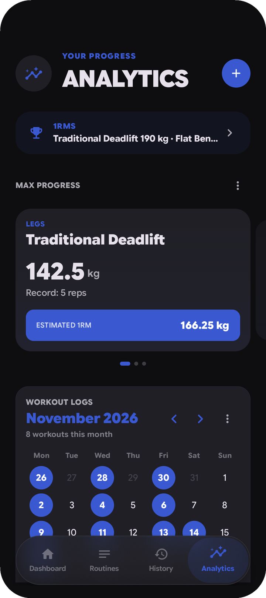
  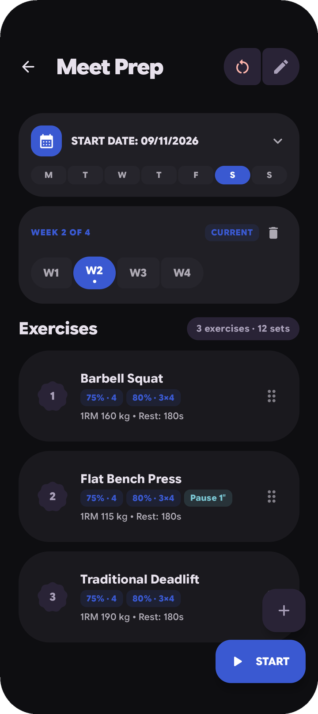
  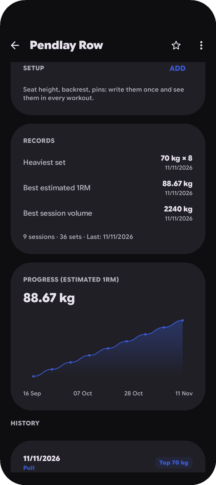
</p>
<p align="center">
  <sub>Android: the dashboard during a workout, routines grouped by program, a routine and a workout in progress. History by month, analytics, a weekly %1RM program and exercise records.</sub>
</p>

<p align="center">
  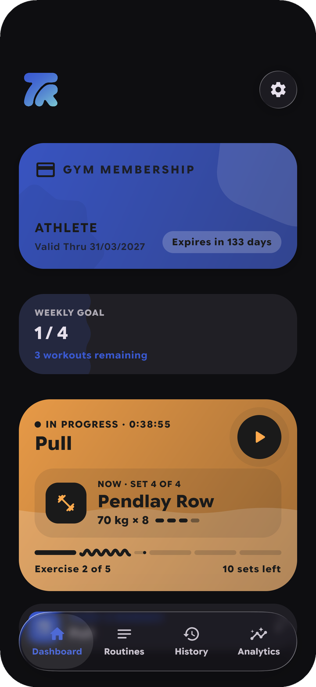
  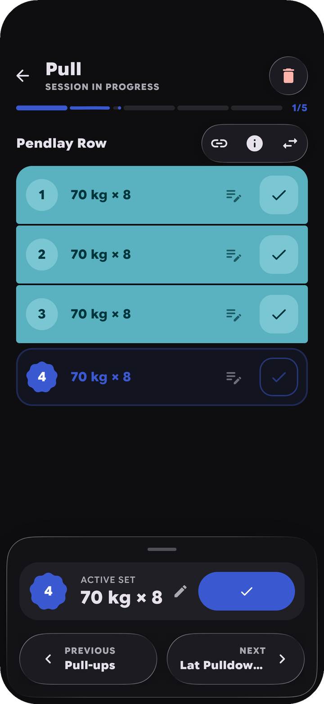
  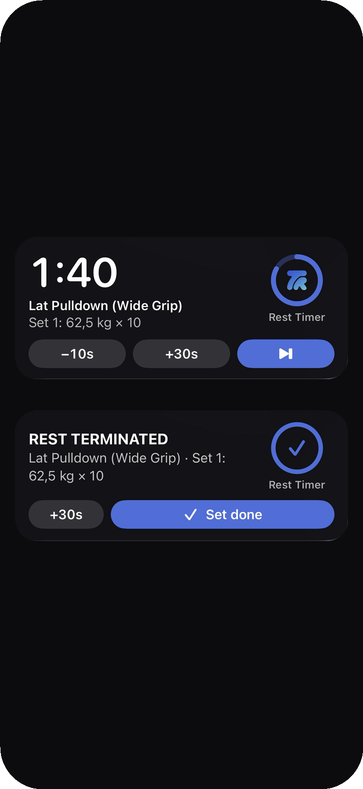
  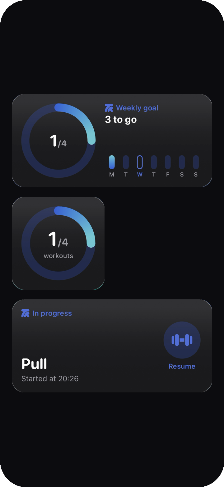
</p>
<p align="center">
  <sub>iPhone, with the optional Liquid Glass theme: the dashboard, a workout, the rest timer as a Live Activity and the Home Screen widgets.</sub>
</p>

## Overview

Trainable is a workout tracker for strength training. It handles a plain push, pull and legs split as well as week-by-week %1RM programs, and it works without an account or an internet connection.

- **Android and iPhone.** Since version 3.0 the same app runs on both. The screens and the logic are shared with Kotlin Multiplatform and Compose Multiplatform, so the two versions behave the same and a backup moves between them.
- **Local first.** Everything lives in a database on the device. Backups go to a file or to your own Nextcloud.
- **Simple by default.** Percentage-based programming, techniques and RPE targets sit behind one switch (Settings, Workout, Advanced programming) that stays off until you need it.
- **Scan a paper plan.** Photograph a gym sheet and let an on-device model, or a provider you choose, turn it into a routine.
- **Your language and units.** English, Italian, Portuguese, German, French and Spanish, in kilograms or pounds and kilometres or miles.

## Features

### Training

- **Dashboard.** The routine for today, weekly goal progress and a live card while you train: the rest timer, the next set and the sets left. An optional workout mode turns it into a full panel with "Set done" and the exercise list.
- **Routines and groups.** Group the routines of a program under one name and colour. "Your week" shows the routine of each day, and each routine can have a photo, weekdays, a start date and an expiry date.
- **Routine builder.** More than 150 preset exercises with filters by category, muscle and equipment, plus your own exercises and categories, favorites, supersets and drag-and-drop ordering.
- **Flexible rep schemes.** Fixed sets, per-set lists such as `10-8-6`, rep ranges with double progression, optional starting weights, timed sets and cardio linked to its own exercises.
- **Workout screen.** Large wheel pickers, a rest timer with notifications, a warm-up timer, per-set notes, previous and next with a hold to see the whole workout, adding or swapping exercises, a plate calculator and optional RPE on three scales.
- **Starting values.** Each set starts from what you did last time in that routine, or from what the routine says, as you prefer.
- **Machine setup.** Save seat height, backrest angle or pins once and see them above the sets of every workout.
- **Timed sets that run on their own.** At the target the set is logged, the rest runs and the next timed set starts by itself.
- **Set detail.** Optional logging of rest-pause parts, assisted and partial reps and the technique actually performed.

### Advanced programming

Opt-in. With the switch off the app behaves like a plain tracker, and your programmed data is kept for when you turn it back on.

- **Prescriptions as blocks**, for example `70% 5 / 75% 3x5 / 70% 6`, with %1RM, RPE, fixed load or bodyweight intensity.
- **Every rep mode.** Sets by reps, per-set lists, AMRAP and total-rep targets that add sets until the goal is reached.
- **Techniques.** Pauses, chains, bands, tempo, deficit, EMOM and custom cues, shown as chips everywhere.
- **Weekly programs.** Any number of weeks with a prescription per week, skipped weeks, copy from the previous week and automatic week advance after each session.
- **1RM manager.** Per-exercise maxes with history and source (tested, manual or estimated), an Epley estimate from your logs and a load table rounded to your plate increment.
- **Edit while training.** Change a prescription in the middle of a workout, for that workout only or for the whole routine.

### History and analytics

- **History.** Workouts grouped by month with their volume, a sheet with every set of a workout, and a filter by routine, group or month. Edit past workouts, compare two sessions and share a workout as an image card.
- **Journal.** An optional rating, note and coloured tags for each workout.
- **Heart rate (Android).** Average and maximum heart rate, calories and time in each zone from your watch or band, read through Health Connect.
- **Analytics.** Widgets you pick from a gallery and arrange yourself: workout calendar, body weight, volume by muscle group, total tonnage, 1RM progress and period comparison, each with its own period.
- **Exercise records.** Per exercise: heaviest set, best estimated 1RM, best session volume and a progress chart.
- **Reports.** An HTML report of one or more routines with per-exercise history, maximums and, for programs, prescribed versus done by week.

### AI sheet scanner

- **On-device by default.** Google LiteRT-LM running Gemma 4. No account, no API key, and no data leaves the phone. Android runs E2B or E4B on devices with about 6 GB of RAM; iPhone runs E2B.
- **Or a provider you choose.** Claude, OpenAI, Gemini or any OpenAI-compatible server, such as Ollama or LM Studio on your own computer. Keys are stored encrypted, and you confirm before a photo is sent to a public service.
- **Reads real sheets.** Exercise names, sets, reps and rep ranges, rest, cardio, %1RM notation, techniques and multi-week programs, matched against the exercise catalog. You review everything on top of the photo before anything is imported.

### Data and integrations

- **Backup and restore.** ZIP backups to a file, automatic backups on a schedule and optional Nextcloud sync. A backup made on Android restores on iPhone and the other way round.
- **CSV.** Export your history, or import one from another app with a full preview, duplicate detection and a one-tap undo.
- **Routine sharing.** Export and import routines as `.trainableplan` files, photos included.
- **Widgets.** Routine of the day, weekly goal and a 1x1 quick start on the Android home screen; the same three on the iPhone Home Screen, plus a Lock Screen widget.
- **Rest timer outside the app.** A notification on Android and a Live Activity on iPhone, with "Set done" and more rest when the rest ends.
- **Local web dashboard (Android).** Start a small server from Settings and browse your plans, history and analytics from any browser on the same Wi-Fi network.

### Physical checks

A hidden section for body progress, opened by tapping the logo on the dashboard three times: measurements with notes, photos with a fullscreen viewer and a before and after slider, a built-in photo editor, biometric or PIN lock, optional AES-256-GCM encryption of the photos and auto-lock when the app goes to the background.

### Personalization

- **Themes.** Colours from your wallpaper (Android 12 and newer), from a photo, from a preset or from your own colour, with nine styles, three contrast levels, pure black and saved themes. Light, dark or system mode.
- **Liquid Glass.** An optional glass look for the navigation bar, buttons, sliders and the workout panel, each part with its own switch.
- **Navigation bar.** Floating, expressive or classic.
- Gym membership card with expiry alerts, haptic feedback and swipe or long-press interaction styles.

## Installation

### Android

1. Download [`Trainable.apk`](https://github.com/Emanuel5014/Trainable/releases/latest/download/Trainable.apk) from the latest release.
2. Open it on your phone and allow installs from that source when asked.
3. New versions are announced inside the app, which downloads, checks and installs them. In Settings, About you can also choose to receive beta versions.

| Requirement | Detail |
| :--- | :--- |
| Android | 9 (API 28) or newer. Wallpaper colours need Android 12 or newer. |
| On-device AI | About 6 GB of RAM and at least 3 GB of free storage for the model. Remote providers work on any device. |
| Heart rate | Health Connect, and a watch or band app that writes heart rate to it. |

### iPhone

Trainable is not on the App Store. It is installed with [AltStore Classic](https://altstore.io), which signs apps with your own Apple ID through AltServer on a Mac or PC.

1. Install AltServer on your computer and AltStore on your iPhone, following the [AltStore guide](https://faq.altstore.io).
2. On your iPhone, tap the button below. AltStore opens and asks to add the Trainable source.

   <a href="https://trainableapp.vercel.app/altstore/add/"></a>

   Or add it by hand: in AltStore open Browse, then Sources, and add `https://trainableapp.vercel.app/altstore/source.json`.
3. Install Trainable from that source. AltStore offers the new versions when they come out.

You can also download the `.ipa` from the [releases](https://github.com/Emanuel5014/Trainable/releases) (tags starting with `ios-`) and open it with AltStore. With a free Apple ID, AltStore has to refresh the app every 7 days, which it does in the background while AltServer is reachable.

| Requirement | Detail |
| :--- | :--- |
| iOS | 17 or newer, on iPhone. |
| Computer | A Mac or Windows PC running AltServer, on the same Wi-Fi network for the weekly refresh. |
| On-device AI | A recent iPhone with enough memory for Gemma 4 E2B. Remote providers work on any iPhone. |

## Build from source

```bash
git clone https://github.com/Emanuel5014/Trainable.git
cd Trainable
```

**Android.** Needs a recent Android Studio, the Android SDK platform 37 and JDK 21 (Gradle finds an installed JDK or downloads one).

```bash
./gradlew :app:assembleDebug
```

The APK is written to `app/build/outputs/apk/debug/`. The debug build uses the application ID `com.emanuel5014.trainable.debug`, so it installs next to the release version without touching its data.

**iPhone.** Needs a Mac with Xcode 27 and JDK 21. Open `iosApp/iosApp.xcodeproj`, choose the `iosApp` scheme and an iPhone or a simulator, and run. A build phase compiles the shared Kotlin code with Gradle, so the first build takes a few minutes. The on-device AI package is fetched with Git LFS, so `git-lfs` has to be installed.

## Architecture

The app is one Kotlin Multiplatform project. Most of the code is shared between Android and iOS, and each platform keeps a thin layer for what only it can do.

| Module | Contents |
| :--- | :--- |
| `shared` | Domain logic (prescriptions, suggestions, RPE, EMOM, CSV import), the Room database and its migrations, repositories, preferences, backup format and Nextcloud client. |
| `sharedUi` | Every screen, written once in Compose Multiplatform with Material 3 Expressive: navigation, theme engine, Liquid Glass, onboarding and the view models. |
| `app` | The Android app: Hilt, WorkManager, notifications, Glance widgets, Health Connect, the local web server, the in-app updater and on-device AI. |
| `iosApp` | The iOS host in Swift: app lifecycle, Live Activities and WidgetKit widgets, background backup tasks and on-device AI. |

```
Trainable/
├── shared/      Domain, data (Room, DataStore), backup, shared logic for both platforms
├── sharedUi/    Compose Multiplatform screens, components, navigation and theme
├── app/         Android application
└── iosApp/      iOS application (Swift), Live Activities and widgets
```

## Tech stack

| Area | Library |
| :--- | :--- |
| Language | Kotlin 2.4 (Multiplatform) and Swift |
| UI | Compose Multiplatform 1.12 with Material 3 Expressive; Jetpack Compose (BOM 2026.09) on Android |
| Glass and shapes | Kyant Backdrop 2.0, Haze 1.7, androidx graphics-shapes |
| Themes | MaterialKolor 6 |
| Database | Room 2.8 (Multiplatform) with KSP and the bundled SQLite driver |
| Preferences | DataStore 1.2 |
| Dependency injection | Hilt 2.60 (Android) |
| Background work | WorkManager 2.12 and foreground services (Android), BackgroundTasks (iOS) |
| Navigation | Navigation Compose 2.9 |
| Networking | Ktor 3.5 and OkHttp 5.5 |
| Serialization | kotlinx.serialization 1.11 |
| On-device AI | LiteRT-LM (Gemma 4) |
| Health | Health Connect 1.1 (Android) |
| Widgets | Glance 1.2 (Android), WidgetKit and ActivityKit (iOS) |
| Charts | Custom Compose Canvas drawing |
| Build | Gradle 9.6, Android Gradle Plugin 9.4 and Xcode 27 |

## Contributing

Bug reports and feature requests are welcome in the [issue tracker](https://github.com/Emanuel5014/Trainable/issues). For a code change, open an issue first so the approach can be discussed.

## Support

If Trainable is useful to you, a star on GitHub helps other lifters find it. Development can also be supported on [Ko-fi](https://ko-fi.com/emanuel5014).

## License

Released under the [GNU General Public License v3.0](LICENSE).

Logo by br1_production.
